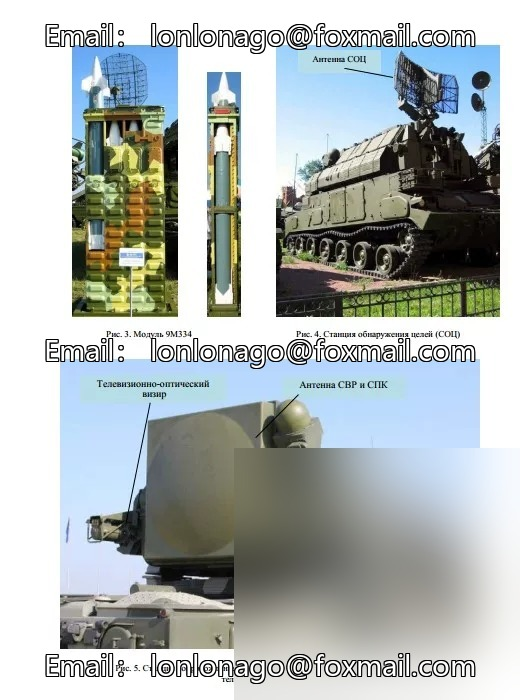
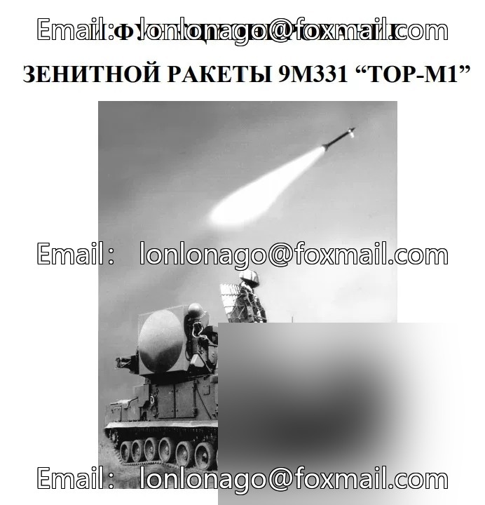
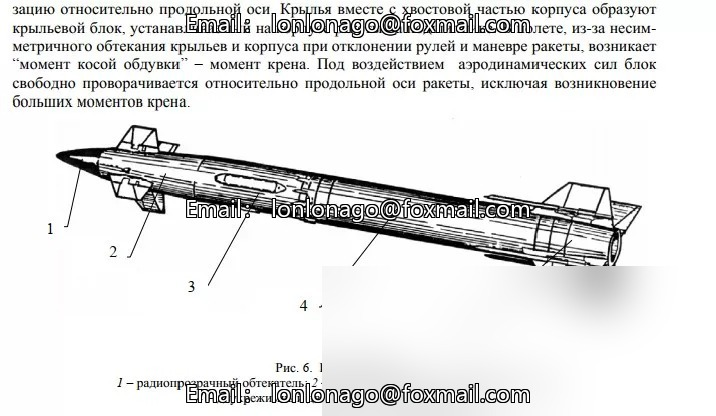
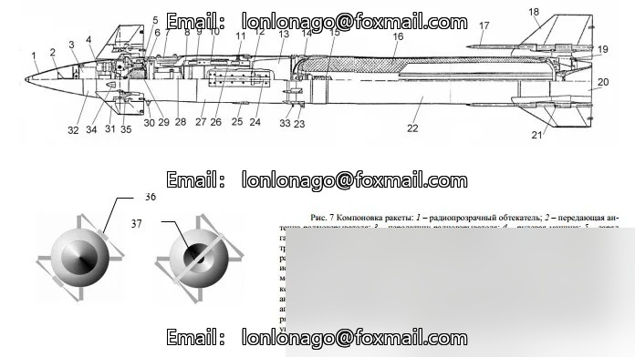
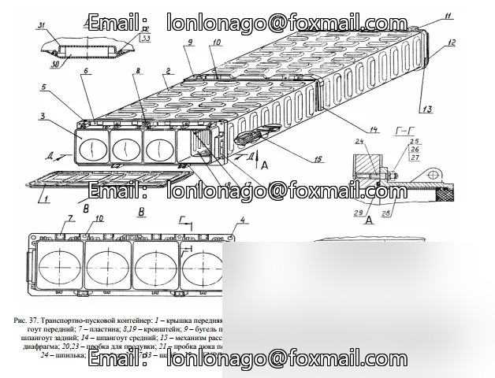
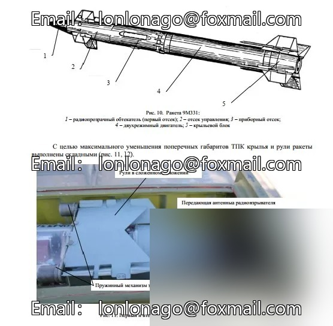

# "Tor-M1" (Doer-M1) - Two sets of core teaching materials for the air defense missile system

## Body

"Tor-M1" (Dol-M1) - two sets of core teaching materials for the air defense missile system.
"The Tor-M1 Air Defense Missile System Teaching Manual (2015)"
"9M331 Missile Structure and Function (2005)"
are copyable, and they are not returned after sale.

This is teaching material for the Tor-M1 air defense missile system, covering two core sets, including multiple manuals, structural and functional documents, and a statement on replicability.

<!-- AI_ENRICHED -->

## Images

## Payment

Here is a pay link on Stripe ( https://buy.stripe.com/3cs8yP7sY87d0vu9AB ). Please contact me lonlonago@foxmail.com after funding $89, and I will send you a complete data files , thank you!

